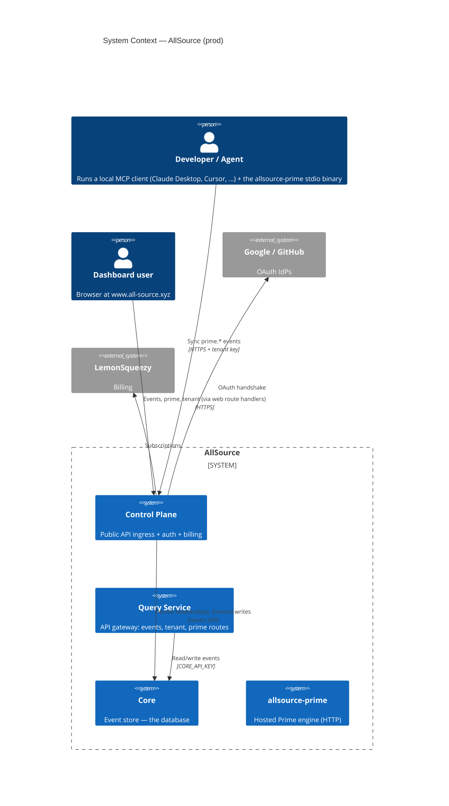
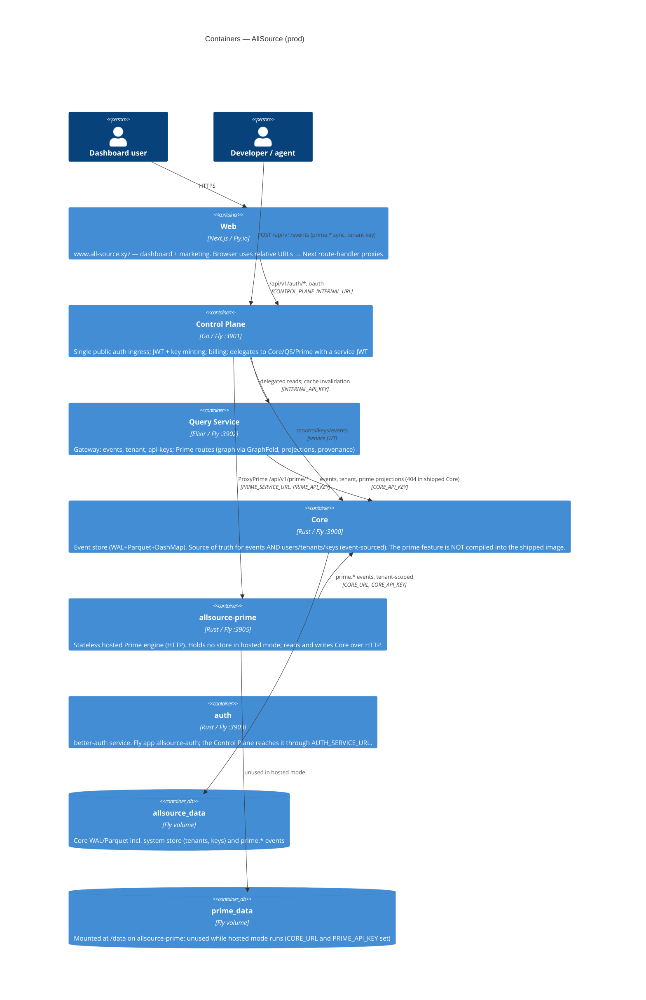
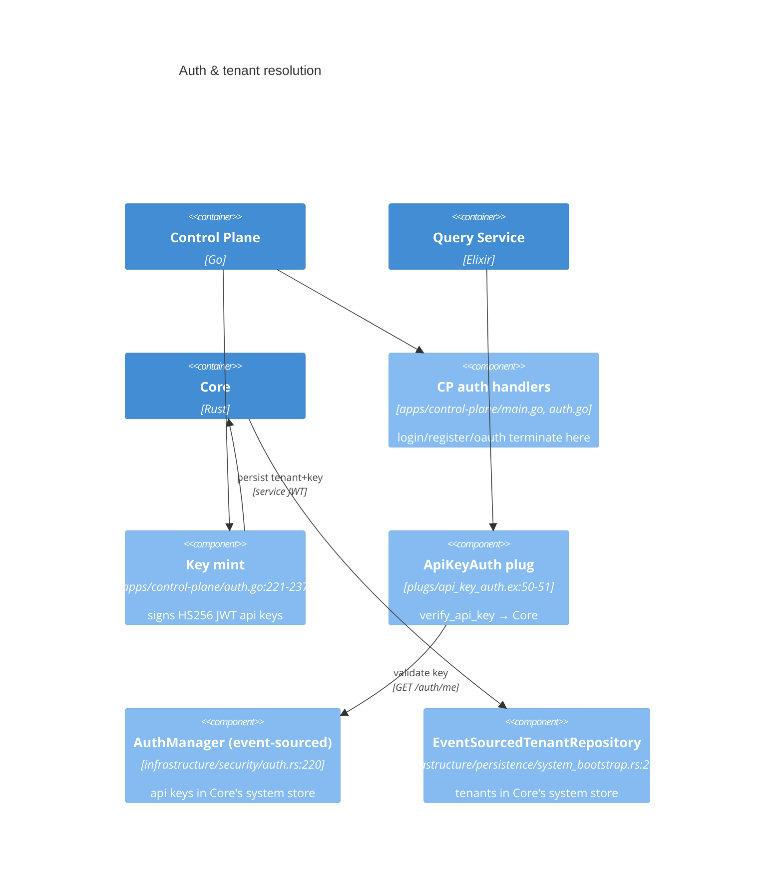
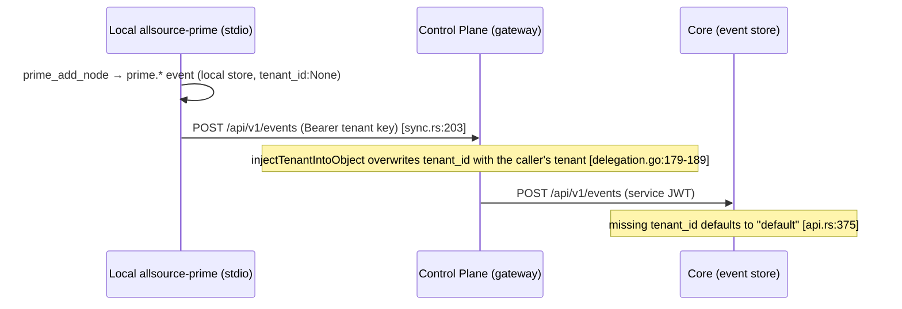

# AllSource — Production Data-Flow (C4-style)

*Status: current-architecture trace of the production request paths. Each claim cites file:line in this repo. Checked against the code on 2026-11-24.*

Prime design: [ADR-020](../adr/020-prime-stateless-over-core.md), [proposal](../proposals/PRIME_STATELESS_OVER_CORE.md).

---

## Edge routing

- `api.all-source.xyz` is the Control Plane. The web app sets `NEXT_PUBLIC_API_URL`, `NEXT_PUBLIC_CONTROL_PLANE_URL` and `ALLSOURCE_API_URL` to it (`apps/web/fly.toml:13-14,24-25,34`).
- The Control Plane serves the `/api/v1` group (`apps/control-plane/main.go:614`). Its catch-all `api.Any("/prime/*path", cp.ProxyPrime)` (`main.go:667`) matches every `/api/v1/prime/*` request.
- `allsource-prime` is the Fly app in `apps/prime-mcp/fly.toml:18`. The Control Plane reaches it at `PRIME_SERVICE_URL`, default `http://allsource-prime.internal:3905` (`main.go:353-355`). The app also has a public `http_service` (`apps/prime-mcp/fly.toml:31-49`). With `PRIME_API_KEY` set, its `/api/v1/prime/*` and `/mcp` routes require that bearer key (`apps/prime-mcp/src/http.rs:516-533`).

---

## Scope & method

This traces what the **production** system actually does — which binaries ship with which features, where data physically lives, and which service answers each request — rather than the intended design. Every claim is grounded in code (`path:line`). Where the code does not settle a question, the question is listed under Decisions for the owner.

The headline: six deployables. Public traffic enters through the Control Plane. Hosted Prime holds no store of its own; its data is `prime.*` events in Core. Two Prime paths can still fail: the Query Service Prime routes (Core returns 404 for them in the shipped image) and the allsource-prime fallback to its `/data` embedded store when `PRIME_API_KEY` is unset.

---

## C1 — System Context



**People & externals**
- **Dashboard user** → `www.all-source.xyz` (`allsource-web` on Fly.io).
- **Developer/agent** → local `allsource-prime` stdio binary + an MCP client; optionally syncs to the hosted backend.
- External: Google/GitHub OAuth, LemonSqueezy billing.

---

## C2 — Containers (deployables)



| Container | Build (features) | Port | Fly app | Role | Evidence |
|---|---|---|---|---|---|
| **web** | Next.js, `apps/web/Dockerfile` | — | `apps/web/fly.toml` | Dashboard, marketing, route-handler proxy | `apps/web/fly.toml:13-34` |
| **control-plane** | Go, distroless `nonroot` | 3901 (`main.go:39`) | `allsource-control-plane` (`apps/control-plane/fly.toml:4`) | Public ingress, auth/OAuth, JWT and key minting, billing, delegation | `main.go:614,667` |
| **query-service** | Elixir release, `ALLSOURCE_EDITION=enterprise` in `fly.toml` | 3902 (`config/runtime.exs:67`) | `allsource-query` (`apps/query-service/fly.toml:5`) | Gateway for events, tenant, api-keys; Prime routes | `fly.toml:16,24`; `router.ex:520-527` |
| **core** | `--features enterprise,analytics` (no `prime`) | 3900 (`Dockerfile:229`) | `allsource-core` (`apps/core/fly.toml:7`) | Event store; source of truth for events and system metadata | `apps/core/Dockerfile:191,197` |
| **allsource-prime** | `allsource-core` with `prime-recall`, `prime-vectors`; default `prime-bundled-model` | 3905 (`fly.toml:26`) | `allsource-prime` (`apps/prime-mcp/fly.toml:18`) | Hosted Prime engine, stateless in hosted mode | `apps/prime-mcp/Cargo.toml:27,44`; `fly.toml:24-29` |
| **auth** | Rust, `apps/auth/Dockerfile` | 3903 (`Dockerfile:78`) | `allsource-auth` (`apps/auth/fly.toml:10`) | better-auth service | `apps/control-plane/fly.toml:17` (`AUTH_SERVICE_URL`) |


---

## C3 — Components that matter

### Auth / tenant / key ownership — **Core, not PostgreSQL**



- API keys, tenants, and users are event-sourced in Core's system store (`apps/core/src/infrastructure/security/auth.rs:220`, `apps/core/src/infrastructure/persistence/system_bootstrap.rs:23-28`). The Control Plane starts with `Persistence: core (no PostgreSQL)` (`apps/control-plane/main.go:1275`). The Query Service keeps only a tenant cache (`apps/query-service/lib/query_service_ex/tenant_cache.ex`) that the Control Plane invalidates.
- The mint returns a signed HS256 JWT as the API key, not a Core-stored `ask_` row (`apps/control-plane/auth.go:221-237`, shared `JWT_SECRET`). Keys with the `ask_` prefix are validated by delegating to Core (`auth.go:291-295,452`). Both forms validate at Core `/me`.

### Trust tiers
1. **Public → Control Plane**: CP applies `AuthMiddleware` to the routes it serves (`apps/control-plane/main.go:507`).
2. **Control Plane → Core**: CP signs a 365-day admin service JWT (`UserID=control-plane`, `TenantID=system`, `main.go:193-198`) and injects the resolved tenant. Backends trust CP, never the caller.
3. **Control Plane → allsource-prime**: `X-Tenant-Id`, `X-User-Id` and the `PRIME_API_KEY` bearer (`apps/control-plane/delegation.go:497-516`). Without `PRIME_API_KEY` on the Control Plane, it sends the user-scoped service JWT and a `tenant_id` query parameter instead (`delegation.go:507-515`).
4. **Query Service → Core**: `CORE_API_KEY` bearer (`apps/query-service/lib/query_service_ex/infrastructure/adapters/rust_core_client.ex:128-130`). **CP → QS**: `INTERNAL_API_KEY` (`apps/query-service/lib/query_service_ex_web/plugs/internal_api_key.ex`).

---

## Dynamic flow 1 — Login (OAuth)

1. Browser → `/api/v1/auth/oauth/:provider` (relative) → Next route `apps/web/src/app/api/v1/auth/oauth/[...path]/route.ts` → **Control Plane** (`CONTROL_PLANE_INTERNAL_URL`, `apps/web/fly.toml:30`).
2. CP ↔ Google/GitHub (client IDs read in `apps/control-plane/oauth.go:54-62`). CP mints a session JWT with user ID, username, email, name, tenant, role and provider, expiring after 7 days (`apps/control-plane/auth.go:638-653`), then redirects to `/api/auth/callback?token=…`.
3. Web sets the `auth_token` httpOnly cookie (`apps/web/src/app/api/auth/callback/route.ts:75-79`).
4. Subsequent `/api/*` calls send the cookie. The Next proxy translates it to `Authorization: Bearer` for the backend (`apps/web/src/app/api/[...path]/route.ts:62`).

## Dynamic flow 2 — Event ingest + Prime sync



- `sync.rs` sends `prime.`-prefixed events to `<remote>/api/v1/events` with a bearer credential (`apps/prime-mcp/src/sync.rs:203`).
- Tenant stamping happens at the Control Plane (`delegation.go:179-189`, applied to single and batch ingest at `delegation.go:450-453`). Core defaults a missing `tenant_id` to `"default"` (`apps/core/src/infrastructure/web/api.rs:375,420,472`). Sync must therefore target the CP gateway (`https://api.all-source.xyz`). Sync pointed straight at Core lands under `"default"`.

## Dynamic flow 3 — Prime reads and writes

```mermaid
sequenceDiagram
  participant Client as Client (tenant key or session)
  participant CP as Control Plane
  participant PrimeApp as allsource-prime (hosted)
  participant Core as Core
  Client->>CP: GET or POST /api/v1/prime/* 
  CP->>CP: resolve tenant from auth context
  CP->>PrimeApp: ProxyPrime: X-Tenant-Id, X-User-Id, PRIME_API_KEY bearer [delegation.go:497-516]
  PrimeApp->>PrimeApp: check bearer; select tenant cache [http.rs:516-533]
  PrimeApp->>Core: prime.* events for the tenant (cache miss)
  Core-->>PrimeApp: tenant's events only
  PrimeApp-->>CP: response
  CP-->>Client: response
```

- The forwarded path is `/api/v1/prime/<suffix>`. `/api/v1/prime/mcp` maps to `/mcp` on the Prime app (`delegation.go:476-482`).
- Event reads: `GET /api/v1/events/query` has its `tenant_id` forced to the caller's tenant before it reaches Core (`delegation.go:616-649`).
- Query Service Prime routes (`apps/query-service/lib/query_service_ex_web/router.ex:520-527`):
  - `graph` folds the tenant's `prime.*` events from Core in Elixir (`controllers/prime_controller.ex:40-53`, `apps/query-service/lib/query_service_ex/prime/graph_fold.ex`).
  - `projections`, `project` and `provenance` call Core's `/api/v1/prime/*` (`prime_controller.ex:60-94`). The shipped Core does not serve those paths.
- These QS routes are not on the public path. The Control Plane catch-all takes `/api/v1/prime/*` first (`main.go:667`).

---

## Prime stores

| Store | Backing | Written by | Read by | Durable |
|---|---|---|---|---|
| Local embedded | `PRIME_DATA_DIR`, default `~/.prime/memory` (`apps/prime-mcp/src/main.rs:92`) | local stdio and local http MCP tools | local agent | local disk |
| Core `prime.*` events | Core WAL and Parquet (`allsource_data`) | sync through the Control Plane (`sync.rs:203`); hosted writes (`apps/core/src/prime/hosted.rs`) | `HostedPrime` over HTTP (`apps/core/src/prime/http_core.rs`); QS `GraphFold` | yes |
| `/data` on allsource-prime | embedded store | fallback path only (see above) | fallback path only | yes, on the volume |
| Core-embedded Prime | `prime` feature (`apps/core/Cargo.toml:80`) | not compiled into the shipped Core image | n/a | not deployed |

Design rationale: [ADR-020](../adr/020-prime-stateless-over-core.md). It rejected Core-embedded Prime.

---

## Known gaps in the current wiring

1. **Core does not serve Prime in the shipped image.** `prime` is an optional feature (`apps/core/Cargo.toml:80`). The image builds `enterprise,analytics` (`apps/core/Dockerfile:191,197`). The Prime router is behind `#[cfg(feature = "prime")]` (`apps/core/src/infrastructure/web/api_v1.rs:586`), so Core answers `/api/v1/prime/*` with 404.
2. **QS `projections`, `project` and `provenance` fail against the shipped Core.** They call Core's `/api/v1/prime/*` (`prime_controller.ex:60-94`). The hosted app's route table has no `/api/v1/prime/projections` entry (`apps/prime-mcp/src/http.rs:137-383`), so the public path returns 404 as well.
3. **The QS `graph` route is not on the public path.** The Control Plane catch-all (`main.go:667`) serves `/api/v1/prime/graph` from allsource-prime. QS GraphFold runs only when a client calls the Query Service directly.
4. **Misconfigured key moves allsource-prime to its `/data` store.** The Control Plane forwards with `PRIME_API_KEY` when set and with a user JWT when unset (`delegation.go:507-515`). allsource-prime with `CORE_URL` but no `PRIME_API_KEY` opens its embedded store (`main.rs:378-387`). The two sides must be set together.
5. **Sync tenanting depends on the gateway.** See flow 2. Sync pointed at Core lands under `"default"`.
6. **`prime_data` is mounted and unused in hosted mode** (`apps/prime-mcp/fly.toml:56-60`). The file comment defers removal to a maintenance window (`fly.toml:13-14`).

---

## Decisions for the owner

1. Fallback policy: should allsource-prime refuse to start when `CORE_URL` is set and `PRIME_API_KEY` is not, instead of opening the `/data` store (`apps/prime-mcp/src/main.rs:378-387`)?
2. QS Prime routes: keep `projections`, `project` and `provenance` (`router.ex:524-527`) returning Core's 404 until the hosted engine serves them, or remove those routes?
3. Auth: is `allsource-auth` deployed? The Control Plane sets `AUTH_SERVICE_URL` (`apps/control-plane/fly.toml:17`) and also keeps Go auth handlers (`apps/control-plane/main.go:548`). Which service owns login?
