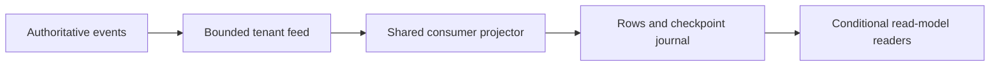

# Shared tenant read model

Status: local verification complete; production rollout pending.

## Contract

Authenticated consumers read a bounded tenant change feed and maintain named
read models. A commit atomically persists row changes and its source checkpoint
under a revision compare-and-swap. Idle readers exchange metadata rather than
replaying source history. Application-specific folds remain in the consumer.

The feed excludes read-model journal events. Checkpoint-only commits preserve
content revisions. Intermediate batches remain unready until the final source
checkpoint is published. Competing writers must retry after a revision conflict.
Each returned event carries its source position in an aligned `positions` array.
Positions preserve filtered gaps and let consumers deduplicate partially committed
pages without assuming entity versions describe feed order. Consumers reject a
nonempty page with missing, unordered or out-of-range positions.
HTTP ingestion rejects reserved journal names. Authentication binds every feed,
model read and model write to its tenant; the gateway meters successful reads
and refuses exhausted egress budgets before contacting Core.

## Bounds and recovery

| Boundary | Limit |
| --- | --- |
| Feed page | 500 events and 512 KiB |
| Feed scan | 10,000 positions per request |
| Model commit | 500 changes and 240 KiB |
| Model page | 500 rows and 128 KiB |
| Model state | 32 MiB and 100,000 tracked keys |

Responses use bounded admission. Journal restoration verifies revision order.
Restart or affected-tenant eviction changes the feed epoch; old cursors refuse
and consumers rebuild. Unrelated tenants retain their cursors. This release
requires stable routing to one authoritative Core process per tenant.
Cross-process cursor coordination is outside this protocol.

Cold feed discovery and model restoration certify and hydrate tenant archive
state. Response bounds do not imply a bounded cold archive working set. Deploy
only after checking archive size, admission and process routing for the tenant.

## Verification

Core scoped checks cover tenant isolation, byte limits, atomic
checkpoints, competing writers, durable restoration, epoch invalidation,
response admission, rate-limit separation and reserved-journal sync refusal
before any batch write. Core Clippy passes with warnings
denied. Gateway metering and hard-budget refusal tests pass.
Eight feed and durable read-model tests pass with per-event source positions,
including filtered gaps and restart recovery.

Real HTTP model-handler tests run five idle rounds with 1, 5 and 20 clients.
Conditional response bodies total 695, 3,475 and 13,900 bytes respectively, with
zero source-event payload bytes. Metadata and HTTP headers are excluded.
Consumer integration additionally verifies idle readers across two API replicas,
queue transitions, membership revocation and reader restart. Production bandwidth
improvement remains unverified.

## Rollout

1. Deploy Core and gateway together with existing finite tenant egress budgets.
2. Warm the consumer projector while existing authoritative readers remain active.
3. Confirm a ready checkpoint, then enable projected reads on consumer replicas.
4. Verify existing workflows and compare total egress across producer and consumer
   services. Keep production verification read-only.

Rollback disables consumer projected reads and the worker independently. Source
events remain authoritative; persisted journal events do not enter the feed.
