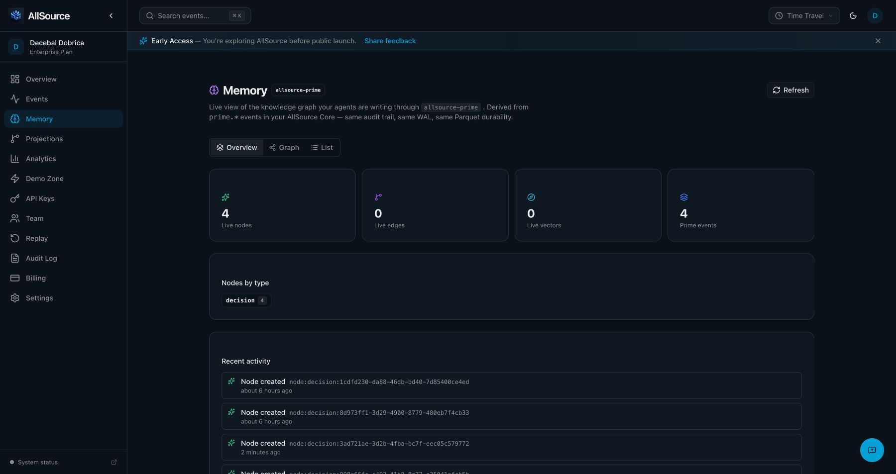

# Hosted Prime sync verification

The synthetic sync observations in this report bind runtime source `f1ede26f`. The [current legacy-key compatibility report](2026-10-26-managed-key-lifecycle-verification.md#compatibility-production-readback-2d48fd16) records the subsequent deployed source, unchanged existing-key admission and independent hosted identity readbacks.

## Result

Hosted sync and credential lifecycle passed through real authenticated Codex and Claude native skills after both repaired gateways deployed. Two fresh synthetic decisions reached the tenant, survived a local Prime process restart, and were read independently through hosted Core and hosted Prime. The dashboard displayed both exact entities. Old and new revoked credentials returned HTTP 401 through both deployed gateways.

The initial qualification exposed revoked-key acceptance and an incorrect year-long JWT lifetime. The [lifecycle repair report](2026-10-26-managed-key-lifecycle-verification.md) records the accepted compatibility policy, reviewed source, deployment digests and final HTTP rejection evidence. The fresh proof key's JWT and Core metadata both matched its requested 30-day expiration. Private credential files were removed after rejection was verified.

## Target and source

- Public origin: `https://api.all-source.xyz`; actual health response identifies `allsource-control-plane`, version `0.26.1`, healthy Core, persistence `core`.
- Source base: merged PR #361 at `54c26ea308f38b2adf6b68e3609d6f23b8c2e8af`, isolated from the unrelated dirty primary checkout. Deployed repair source: `f1ede26fedc7d3bc1d12c60938e9e317c25393fa`; all candidate CI passed before rollout.
- Installed Allstack: `0.2.0`. Original native methods and [indexed acceptance request](../reference/hosted-prime-sync-request.md) guide the flow.
- Rebuilt Prime: Cargo reported `fresh:false`; test-target compilation rebuilt its final runtime executable. Executed Prime SHA-256: `46d77838ff4a103bf1f940e457f3f5cafea0c4030a273da241f7eceb46a0c787`.
- Executed final hosted harness SHA-256: `c05534c6a45f3c848cb8bdf53ce3ab50d44dac62326edd3e5f275ee7ca6e4fd5`. The reader receipt binds the same bytes before and after execution.

## Native hosts and actual execution

| Stage | Authenticated host | Evidence |
|---|---|---|
| Plan | Claude `14e1fbb3-eafb-4e1f-ab87-190c2baf350c` | 34 inspected source-read/search calls; source-grounded acceptance plan |
| Build | Codex `01a177c3-56b4-70e3-8c4e-66a1baa018d9` | Initial executable acceptance artifact; coordinator finalized bounded ownership and hosted graph checks |
| Review | Claude `9b10d7c5-83a1-4eed-a943-e093d49529b5` | Both acceptance source files read; no blockers |
| Application repair | Codex desktop, Claude reviews | Gateway lifecycle implementation; real Core and role/scope regressions; source-linked evidence in the repair report |
| Final writer QA | Codex `01a179b6-c14b-75e3-9407-9f91902fde48` | Actual `hosted_prime_sync_write_restart`: 1 passed, 0 failed, 0 ignored; receipt `1de82527-1428-4cc0-8b30-5130e894c740` |
| Final independent reader QA | Claude `ce257513-895c-4de2-8ca6-191090e7288d` | Actual `hosted_prime_sync_independent_readback`: 1 passed, 0 failed, 0 ignored; receipt `2c19612b-b30a-42ba-8c05-f324b8202b30` |

The writer test owns the real local MCP process, writes decision 1, waits for actual hosted delivery and a persisted cursor, closes and reaps the process, reopens the same local store, and reads back decision 1 through MCP. It checks stable remote identity before creating decision 2 and requires a later cursor. Child stdout and stderr remain separate in a private proof directory.

The independent reader starts no local Prime process and opens no writer store. It checks exact hosted Core events and exact hosted Prime nodes, including identity and properties. The actual test executable asserts those HTTP results; its stdout contains the test result, not the response bodies. Browser inspection confirmed both new exact entities among four live decisions and four Prime events; the earlier two synthetic decisions remain in the audit trail.

## Delivered records

Final proof run: `d0b721b4-6f68-4d01-9888-271b675ceac3`. Names are `hosted-sync-proof-<proof-run>-1` and `hosted-sync-proof-<proof-run>-2`; domain `hosted-sync-proof`, ordinals 1 and 2.

| Decision | Exact entity | Hosted event UUID |
|---|---|---|
| 1 | `node:decision:3ad721ae-3d2b-4fba-bc7f-eec05c579772` | `cd484076-38a7-486f-b789-02acbce222d8` |
| 2 | `node:decision:998a66fc-c492-41b8-8e77-e35041afcb5b` | `f746c994-a5b5-4dcd-81d8-d05628c2fe47` |

Persisted cursor advanced from `2026-10-26T19:36:45.198247Z` to `2026-10-26T19:36:49.767618Z`. Exactly one hosted event matched each entity and its expected properties. Remote IDs remained unchanged across restart. Synthetic nodes remain in the tenant audit trail; unrelated tenant data was not changed.

## Credential observations

The user authorized key `Allstack hosted sync lifecycle proof`, `events:read` and `events:write`, 30-day expiration, and revocation after the proof. The dashboard displayed those scopes and expiration 2026-11-25. The JWT and authoritative record both expire at `2026-11-25T19:34:58Z`; its lifetime is exactly 2,592,000 seconds. The opaque key was captured in a private mode-0600 file without exposing its value to the model, argv, source or project memory. The clipboard was cleared.

Before fresh writes, the new key authenticated an actual strict Core lifecycle-history read with HTTP 200, and its registration scopes and expiration matched the JWT. Missing/invalid authentication returned HTTP 401; the writer checked reads and writes, and the independent reader checked reads only.

During the initial qualification, the original revoked JWT still returned HTTP 200 at `2026-10-26T13:28:20Z` and `13:30:24Z`; its actual expiration was `2027-10-26T12:27:46Z` despite the 30-day request. The hosted state owner already contained its durable revoke. After repair deployment, both that original credential and the newly revoked credential returned HTTP 401 at public Control Plane. Query Service rejected both through Bearer and X-API-Key paths, four additional HTTP 401 observations. The dashboard showed no keys, and both private credential files were removed.

`revoked_hosted_proof_key_is_rejected` executed once per credential against deployed Control Plane and passed both times. Receipts: `5b8f75a5-f68d-49cc-8502-bd164f04a613` (old), `9e16baee-5b2e-4b61-994e-c3ec1e377257` (new). Query Service rejection receipt: `a8479e46-3a95-483e-bdb2-e82131955563`. Dashboard removal and green CI are supplemented by actual authenticated HTTP rejection, rather than treated as revocation evidence themselves.

## Lifecycle authority

Managed JWT issuance now honors requested expiration and persists registration before returning a secret. Both gateways require current Core lifecycle authority and enforce registered scopes within signed roles. Revoke success requires Core acknowledgement. Unregistered long-lived API JWTs are rejected; human sessions and short-lived service delegation retain separate authority.

The [accepted design](../plans/2026-10-26-api-key-lifecycle-repair.md) and [repair verification report](2026-10-26-managed-key-lifecycle-verification.md) record compatibility, real Core restart checks and the deployed images. Human dashboard access remained usable after rollout. Core remained private and was not deployed or restarted. No signing-key rotation or broad credential revocation was performed.

## Underlying services and limits

Chronis root task `t-453353` and native delivery task `t-89337d` own delivery. Project Prime retains source-linked decisions, reviews and QA outcomes. Global MCP Prime is a separate local-only store and does not establish hosted state. The actual hosted HTTP readbacks and deployed image references establish this qualification.

Raw process receipts, Cargo provenance, frozen source digests, sanitized delivery JSON, browser screenshots, and revocation observations remain in private `.allstack/proof/allsource-hosted` state. The public report includes only synthetic identifiers and observed outcomes. Reproduce with the [native verification runbook](../runbooks/HOSTED_PRIME_SYNC.md).

Ordinary CI ignores hosted tests; its result cannot establish hosted synchronization or revocation. Separate coding-host processes were verified on one machine. A second physical computer, another tenant, hosted-server restart durability, and vector retrieval were not verified.
