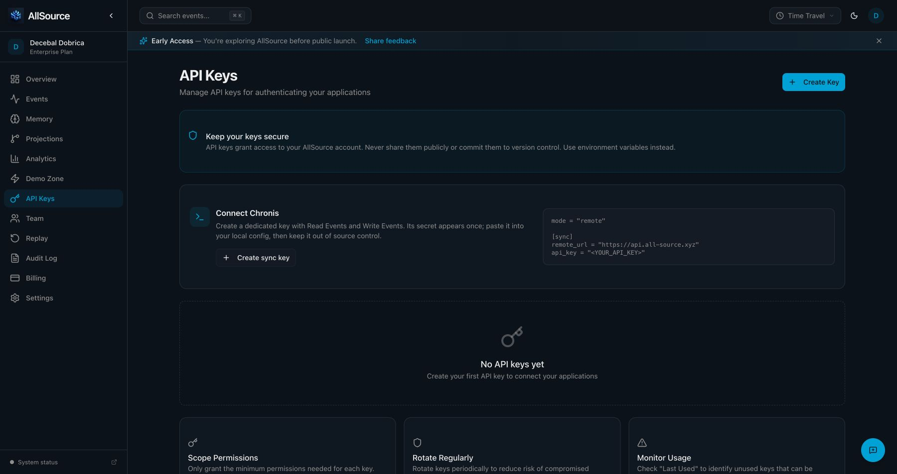

# Managed API key lifecycle verification

## Deployment status

Both gateways are deployed from reviewed candidate `2d48fd16e7af1e287132552887fc03827fbde1df` on [PR #364](https://github.com/all-source-os/all-source/pull/364). Candidate CI passed before rollout. Actual Fly machines matched immutable image digests and reported healthy. Codex and Claude independently used the unchanged existing application credential to receive HTTP 200 with the expected tenant identity. Query Service accepted that key through Bearer and X-API-Key paths and rejected the same protected route without authentication. [Sanitized admission readback](evidence/2026-10-26-legacy-admission-readback.json) records those observations.

The synthetic hosted writer, independent reader and revoked-key proofs below bind the earlier `f1ede26f` deployment on merged [PR #363](https://github.com/all-source-os/all-source/pull/363). Their credentials remain revoked; this compatibility rollout reused an existing application credential without rotation or tenant-data writes.

The [accepted design](../plans/2026-10-26-api-key-lifecycle-repair.md) rejects unregistered long-lived API JWTs. Human sessions and short service delegation retain their separate authority. Native `ask_` keys keep their existing Core-backed validation boundary; this report concerns gateway-managed JWTs.

## Implemented contract

The [legacy compatibility continuation](../plans/2026-10-26-legacy-key-authority-compatibility.md) qualifies a separate existing-tenant case. Its retained history contains nine initial version-one events followed by ordinal ten/version ten, with complete `retained-entity-v1` count and revision metadata. The original strict ordinal reader returned HTTP 401 for that registered key; native regression receipt `6876eb3a-37ac-4369-9cb1-a2723964aa23` reproduces `invalid API key history`. The compatibility reader accepts the initial legacy prefix, requires modern versions to match logical ordinals after transition, and preserves nondecreasing timestamps, unique IDs, complete counts, tenant/entity integrity and terminal revocation. Core reports the maximum retained event version as `entity_version`; a legacy-only stream therefore reports one, while the numbered transition must equal its logical ordinal. Compatibility deployment and existing-key readback passed; the synthetic sync proof below retains its original deployment provenance.

Control Plane and Query Service require current Core lifecycle authority before accepting a managed JWT. The reader checks the complete retained `apikey:{tenant}` stream, including archived events, with explicit protocol, tenant, entity and version integrity. Missing registration, revoked state, unavailable authority and incomplete history deny authentication. A positive identity cache cannot override revocation.

All seven scopes offered by the dashboard are recognized: `events:read`, `events:write`, `queries:execute`, `projections:read`, `projections:write`, `schemas:read` and `schemas:write`. Existing schema and projection operations require their matching scope; read-only roles cannot gain mutation access from metadata. Control Plane schema governance retains its existing `ManageSchemas` role requirement, which excludes service accounts. Query Service tenant schema registration retains its existing write-capable service-account access, now additionally requiring `schemas:write`. Scope metadata does not erase either route-specific boundary. Signed roles constrain the current metadata scopes. Managed keys cannot reach administrative or key-management operations. Control Plane's separate admin middleware rejects programmatic JWTs. Query Service's Bearer, X-API-Key and JWKS fallback paths share the same managed-key contract. View-as sessions remain read-only. Public ingestion rejects lifecycle namespace forgery at the ingestion owner, preserving Control Plane's view-as refusal and audit order.

Finite expiration is encoded in both the JWT and authoritative metadata. The dashboard's existing “Never expires” selection produces an explicitly marked managed JWT without `exp`, backed by an active record with null expiration. That shape requires registration on every request. Explicit null, zero or malformed JWT expiration is rejected. Human sessions and delegation still require finite expiration. Existing finite JWTs retain their own deadline when legacy metadata lacks expiration; reissue an old year-limited credential to obtain a true non-expiring key.

Create and revoke return success only after Core acknowledges a lifecycle event. Appends use the leader client without automatic retries. Identical registration retries are idempotent; conflicting recreation cannot reactivate a revoked identity. Revocation invalidates the dashboard projection, including tombstones for legacy audit-only identities. New onboarding credentials register a distinct key identity before returning a secret.

## Source and runtime evidence

The owned Core fixture was rebuilt from base `54c26ea308f38b2adf6b68e3609d6f23b8c2e8af`, Core tree `3e9f478ae30bcef382dbabc7104948e8f664f1de`, with `community`, `default`, `multi-tenant` and `server` features. Cargo reported a non-fresh executable artifact. Its SHA-256 is `7e91c879f1c4d4888e508a70caaa1c1d49c6f826822c4b8b8604198c4f3e58a7`. No Core source modification or production Core deployment is required for this repair.

The real Control Plane boundary exercises registration, application event ingestion/readback, reserved-stream refusal, durable revocation and same-token rejection after Core restart. The real Query Service HTTP boundary exercises requested-expiry minting, application ingestion/readback, scope refusal, revocation, restart rejection and an active non-expiring reader after restart. Both fixtures own their loopback ports and private Core data directories, and kill/reap their Core processes.

Additional regressions cover unknown, malformed and expired credentials; partial authority; tenant mismatch; duplicate registration; conflicting reactivation; role/scope restrictions; bounded delegation clock skew; human/view-as compatibility; admin rejection; JWKS fallback; and create/revoke persistence failures. Test-only HTTP fixtures preserve the updated connection returned by body reads so connection reuse cannot masquerade as an authentication failure.

Codex desktop implemented the repair. Authenticated Claude reviewed the source and independently executed the compiled Go boundary tests after reading the native `allstack-qa` skill. The final Claude session was `16dbeb27-c560-4c6e-9c60-c0104b7f43b4`; its execution had no permission denials. The source-only optional-expiry review (`5441424f-7974-4762-addc-bb7e1c74fbd0`) reported no P1/P2 finding. Source review and runtime execution are separate evidence.

| Check | Observed result | Native receipt |
|---|---|---|
| Control Plane complete suite | 1,108 passing test/subtest cases; 20 existing opt-in skips | `d8ac90e8-2905-4da5-b13e-17b5c6fa3ea1` |
| Control Plane lint | zero issues | `52ea524a-72df-446d-bc97-c711b55c0f12` |
| Query Service complete default suite | 1,154 tests and six doctests; zero failures, two skipped, 174 excluded | `a52f5be7-cb01-4bdd-9427-243b224c8788` |
| Query Service selected lifecycle/auth suite, including real Core | 42 tests; zero failures | `99c044c2-4ce7-4dee-a5f4-17bd06aed266` |
| Query Service warnings-as-errors compile | exit zero | `3aa34bc8-1cf5-46ab-a44c-703a05288be0` |
| Query Service formatting and strict Credo | formatting passed; zero lint issues | `e341d29c-9ac1-4fe3-8a1c-6a87225914ed`, `06c5ca64-059c-4974-8ef8-9f5c76582759` |
| Query Service type analysis | passed with nine existing ignored findings; no new suppression | `873ec47a-e10b-43b7-9902-b14611908141` |
| X-API-Key and lifecycle tests after unreachable-branch cleanup | 20 tests; zero failures | `7696b618-5889-468b-81c9-d79daffac046` |
| Independent Claude native QA | six tests ran and passed; zero skips/failures, including real Core revoke/restart | `fa0206fb-04f5-4461-8ea3-54732dcb4af6` |
| Advertised-scope compatibility | Control Plane role/operation regression passed under race detector; full suite passed | `99fa162e-88ac-492e-b37e-3250c1644134`, `9ab65e9f-33d3-4f8a-b2f5-0605eb358def` |
| Query Service with all dashboard scopes | 42 lifecycle/auth tests and the full 1,154-test/six-doctest suite passed | `99c044c2-4ce7-4dee-a5f4-17bd06aed266`, `8be10913-3172-4417-b4f9-073eafe80078` |
| Scope compatibility lint/type checks | Go lint, strict Credo and Dialyzer passed | `91cf2eff-ca60-46a3-8279-42873faef719`, `89efbadc-235d-4c00-928d-350cbbc84398`, `8ef744f4-b1c3-47a3-b741-6b3ca8693165` |

[Candidate lifecycle CI](https://github.com/all-source-os/all-source/actions/runs/40384260100) executed the actual Core revoke/restart test in Control Plane and 13 Query Service lifecycle tests with zero failures. [Candidate quality CI](https://github.com/all-source-os/all-source/actions/runs/40384259974) also passed. The frozen native Prime policy executed 142 passing tests plus formatting, Clippy and diff checks; it remains distinct from Go/Elixir verification and hosted acceptance.

Claude checked both executable digests before executing. Its test artifact SHA-256 was `73b5fc64c898d9a683a07497f338ac74e2e16bf8c2da7c5e8c9012eadfe21d5b`, unchanged across execution. The fixture build receipt is `22a1e5d7-f5e1-4cec-926b-56b0ab26a7e5`. Its six cases cover real Core revocation/restart, delegation clock bounds, readonly role restrictions, registered non-expiring keys, null/zero expiration rejection and non-expiring token/record consistency. Claude did not execute the Elixir suite; Codex executed that separate check.

The existing tenant egress workflow now includes both Control Plane and Query Service lifecycle proofs against its built Core server. The original frozen Allstack policy remains the Prime-only policy; these Go/Elixir checks supplement it. Exact candidate CI outcomes belong to the PR checks, and local checks do not establish hosted revocation. The original ignored hosted tests remain separate from middleware checks.

## Legacy authority compatibility qualification

[Sanitized retained-history evidence](evidence/2026-10-26-legacy-key-history.json) records the observed ten-event production shape without payloads, credentials or tenant identifiers.

Core’s retained-query implementation reports `entity_version=max(event.version)`. Readers accept an initial version-one prefix against complete retained counts and that maximum-version contract. After the first numbered event, every version must equal its logical ordinal. Legacy-only histories report revision one. Both languages reject ordinal gaps, a version-one event after the numbered transition, duplicate IDs, wrong tenant/entity, decreasing timestamps and mismatched count/revision metadata. Equal timestamps remain valid. Terminal revocation remains irreversible within a retained history.

Authenticated Claude reviewed the complete final reader source against Core’s implementation in session `50199475-61c6-4288-8788-868ea757321f`, receipt `ad8c6917-0ac6-4ef3-a09c-31d7f026b235`. Its initial missing-test findings produced explicit all-version-one revision-mismatch, equal-timestamp and Go tenant/entity cases. The 1,000-event fail-closed ceiling remains an explicit availability limit. Legacy event order relies on the trusted retained reader; revocation tombstones still prevent recreation from reactivating an identity.

| Compatibility check | Observed result | Native receipt |
|---|---|---|
| Go managed-key race suite with actual Core | 38 passing test/subtest cases, no failures or skips | `9a5d31ad-d0c7-455e-be98-1e3d3cfe3643` |
| Query Service HTTP plugs and actual Core | 15 tests, zero failures, no exclusions | `01103cea-1551-42e2-8148-8ba794f6f373` |
| Full default Control Plane package binary | 370 passing cases, 19 opt-in skips, no failures | `d7a3f883-795b-4b69-8e4f-127aa4292257` |
| Go lint | zero issues | `73647195-9cf4-4fce-a841-fa551196e175` |
| Independent Claude native QA | 38 passing cases, no failures or skips; actual Core revoke/restart executed | `94ae4f6c-e3e0-40fa-8e95-cac0ea308e1a` |

Claude independently checked and executed the race-enabled test binary with SHA-256 `830fe46d983862adb344c70b7c139f2ef0a8b8d2341f53af1e67fa471f68bb2b`; its outer supervised receipt is `c4cea6da-a314-4e2c-b29e-020d7e80eaca`. The native command receipt fingerprints `/usr/bin/env`; separate before/after hashes bind the test executable. Actual tool calls and test output confirm the outcome. Assertions and raw test output bind positive and negative outcomes. Candidate CI qualifies the successor source separately. Query Service execution belongs to Codex, not Claude.

Final scoped candidate checks also passed: 39 Go cases including the invitation denial against real Core (`b4b5060e-d42d-43fc-9afd-2b2883db0e2d`), and 15 Query Service tests including strict numeric revision rejection (`f8ee626b-8966-486a-baf2-c1ae7ac04a4a`). Strict Credo checked 343 files with zero issues. The successor base includes the separately merged egress lease feature. Production Core image revision `05466bca8b64093787878c83e30e0bddd44d3839` still exposes reserve/complete without lease/settle. Gateway rollout must preserve current behavior with the existing `EGRESS_LEASE=off` flag unless fresh Core image readback proves lease support. Compatibility production deployment and pre-existing application-key readback passed, as recorded below.

## Registered credential self-introspection

Exact `GET /api/v1/auth/session` returns only the authenticated caller’s signed identity and tenant. Registered credentials with any valid data scope may inspect that identity if their signed role has read capability. Fresh registration, active state, expiry and terminal revocation checks run before this allowance. Query parameters cannot select another tenant. The allowance grants no event scope, management operation, sibling route or mutation.

The observed hosted denial after legacy-history admission was HTTP 403, `insufficient API key scope`, receipt `5ea5e8a4-c02f-40db-9829-1b7cfe7670ae`. The route was missing from managed-key operation admission. The real `SessionHandler` regression now passes for query-only, write-only and readonly credentials, and rejects revoked, unregistered, malformed-scope and expired credentials. Data scopes remain unchanged; an unregistered sibling route returns 404 and prohibited management/mutation requests return 403.

The scoped Go race run executed 48 passing cases with no skips or failures, including real Core and invitation boundaries (`7ea77568-1fc0-4246-957f-eb6c011ab96e`). Authenticated Claude’s independent source review found no privilege escalation (`c6352186-ad8b-4a49-a66d-feec79213caf`). Hosted self-introspection passed through the deployed allowance, with actual outcomes below.

## Compatibility production readback (`2d48fd16`)

[Candidate quality CI](https://github.com/all-source-os/all-source/actions/runs/40400939782) and [lifecycle proof CI](https://github.com/all-source-os/all-source/actions/runs/40400939783) passed on the exact deployed source. The Go log records 1,151 passing test/subtest cases and 20 opt-in skips. Query Service ran 1,330 tests and six doctests with zero failures, 174 exclusions and two skips; type analysis passed. The frozen native Prime policy independently executed 142 passing tests, with five ignored hosted/opt-in cases, plus formatting, Clippy and diff checks.

| Gateway | Running immutable image digest | Deployment receipt |
|---|---|---|
| Control Plane | `sha256:1f7332268aef3dbd1cb2a4bf6d1c0c69dc0dff1ae0fc629686626cedcf827e0c` | `7742b595-fa99-4828-8a09-4e24122d455a` |
| Query Service | `sha256:2fe4b1ebd565761823c670cd99207479670a5c19c0b59e16f889928fe3fa7eca` | `0616a75a-d822-44ed-bfe1-ec1ac4955af9` |

Application Git trees are `3a321158da8d24280fcde377816b981dd6c3ef1f` for Control Plane and `eca80931ea7a5ed59601ec81e96c096a99d45e1c` for Query Service. Publication also includes a pipeline test-ownership correction. Its runtime build inputs remain identical to the deployed source: Query Service’s Dockerfile copies `lib`, `config`, `priv`, `mix.exs` and `mix.lock`, while excluding tests. The recorded app trees identify the release images, not the later test-only correction. Both gateways returned HTTP 200 from readiness endpoints. Live region, Core routing and machine sizes were preserved. Control Plane uses `EGRESS_LEASE=off` to preserve reserve/complete against the observed Core image `05466bca8b64093787878c83e30e0bddd44d3839`; this workflow did not deploy Core.

Codex’s real application-key session read returned HTTP 200 with `tenant_match=true` in 992 ms (`243083b0-523b-4b14-8501-eaf98dac1df9`). Authenticated Claude session `81bbc681-4c6e-4905-87f9-5db5fef5604e` independently executed the same read-only probe: HTTP 200, matching tenant, 1,449 ms (`9b8ebe8c-d53c-495d-a830-cb55fd638324`). Its outer native receipt is `159ad7a2-8eef-40f4-8743-bd8e473dfa35`. Actual calls, raw output and machine image readback establish the outcome; the script’s SHA-256 stayed `b78511a7921777d4fbf14ca86a937ba5e6a4c829cca96bfa37d59140dda9ea5b`. The protected activation source’s fingerprint remained unchanged. No credential value or identity payload entered this report.

The read-only Query Service entity query refused unauthenticated access with HTTP 401 and accepted both Bearer and X-API-Key credentials with HTTP 200 (`6d54460d-8191-467e-b109-9683123cdf7a`). This qualifies admission through both real hosted header paths; it does not claim new event delivery or vector retrieval.

One immediate post-rollout session probe returned HTTP 401 (`480ff2c4-ffa4-4173-af6a-a5209855493d`). Its denial body was not retained, and captured gateway logs did not establish its cause. Subsequent Codex and Claude probes succeeded. This evidence does not establish a zero-error rollout. Claude’s first compound stat/hash command was denied; permitted separate calls completed the digest checks and actual request.

## Pipeline test process ownership

A fixture’s cleanup owner must outlive its processor. Pipeline fixtures use ExUnit’s supervisor with unique, temporary child identities, so the supervisor terminates and reaps workers. Direct `start_link/1` API cases stop their workers before the test returns; telemetry cleanup callbacks detach handlers without racing process shutdown.

The failing CI observation was `GenServer.stop(...): EXIT shutdown` in the statistics test’s `on_exit` callback ([run 40404041355](https://github.com/all-source-os/all-source/actions/runs/40404041355), seed `318578`). The repaired 24-case module completed 21 executions with that seed: 504 passes, zero failures (`94a95a90-7bd2-4a75-b448-5a748100383d`). Strict Credo passed after the repair. This change affects the test fixture only; production runtime inputs and deployed images remain unchanged. Current publication checks are available on [PR #364](https://github.com/all-source-os/all-source/pull/364/checks).

## Hosted authority and routing

Before repair deployment, the actual hosted strict-history read returned HTTP 200 with exactly two lifecycle events: `apikey.created`, then `apikey.revoked`, versions 1 and 2. Its integrity protocol was `retained-entity-v1`, count and total count were 2, and `has_more` was false. The state owner already held the revoke. Fresh-key validation after deployment read three lifecycle events and confirmed active registration, exact scopes and an expiration equal to the JWT deadline.

Actual Fly configuration places Control Plane and Query Service in `iad`, both using `http://allsource-core.internal:3900`. Control Plane has no configured regional Core URL overrides. The running Core machine has an empty services list; application configuration has no public HTTP service. Its reserved shared IPv4 allocation does not expose a Core data endpoint through Fly Proxy. The tested public ingress remains Control Plane.

## Synthetic hosted qualification (`f1ede26f`)

| Target | Deployed image digest | Deployment receipt |
|---|---|---|
| `allsource-control-plane` | `sha256:dddf102d6165538bad18383fdbd528491102f1e56cae694efa03bdd04174ae88` | `58dd55c7-177b-46ab-ab0d-a07086c97fda` |
| `allsource-query` | `sha256:cc559053e12c480c0cc807a05c9f79fa472ba278c38c9cb6c004433421bdfb64` | `a52916d6-5d0c-445e-9868-39c34c731c7a` |

The deployed application Git trees are `fde2b0d3f893e667e8ba1faed667ff8aada51582` for Control Plane and `63cc871620b20ae7f38054bd6b31d178ab074eec` for Query Service. Existing live configuration and machine sizing were preserved. Core was not deployed or restarted.

Human dashboard access remained usable. The temporary key had exactly `events:read` and `events:write`; its JWT and authoritative record both expired at `2026-11-25T19:34:58Z`, with a lifetime of 2,592,000 seconds. Authenticated Codex session `01a179b6-c14b-75e3-9407-9f91902fde48` executed the hosted writer test: one passed, zero failures/skips, receipt `1de82527-1428-4cc0-8b30-5130e894c740`. Authenticated Claude session `ce257513-895c-4de2-8ca6-191090e7288d` read the native QA skill and executed independent hosted readback: one passed, zero failures/skips, receipt `2c19612b-b30a-42ba-8c05-f324b8202b30`.

The [hosted sync report](2026-10-26-hosted-prime-sync-verification.md) records exact delivered entities, event IDs and cursor movement. Hosted Memory displayed both new nodes. After dashboard revocation, Control Plane rejected the old key (`5b8f75a5-f68d-49cc-8502-bd164f04a613`) and new key (`9e16baee-5b2e-4b61-994e-c3ec1e377257`) with HTTP 401. Query Service rejected both keys through Bearer and X-API-Key paths, four HTTP 401 observations (`a8479e46-3a95-483e-bdb2-e82131955563`). Both private credential files were removed and the clipboard cleared. Synthetic decisions remain in the audit trail.

## Limits

The current strict authority reader accepts at most 1,000 lifecycle events per tenant. Larger, malformed or incomplete histories fail closed; check this bound for other tenants before expanding rollout. The active proof-key validation observed three events. The local restart proof covers owned Core processes, not a hosted Core restart or a second physical computer. Hosted creation of a new non-expiring key and vector retrieval were not exercised. Compatibility qualification reused a separate existing tenant’s credential. Finite-key hosted sync and revocation passed on the original `f1ede26f` deployment; current compatibility readbacks qualify the unchanged existing credential separately. Native source-linked memory and Chronis record publication.

Claude scope review (`3b4004e5-c7d7-4e7b-b2a5-c2a4829d3d1d`, receipt `9b001cb5-9aae-432b-b3ab-f69265d05566`) identified the missing Control Plane `PUT /api/v1/read-models/:name` scope mapping; it now requires `projections:write`, with a readonly-denial regression. Its cross-plane schema-policy observation is an explicit compatibility constraint: Control Plane governance retains `ManageSchemas`; Query Service tenant schema registration retains its write-level service-account boundary. Tests assert both outcomes.
