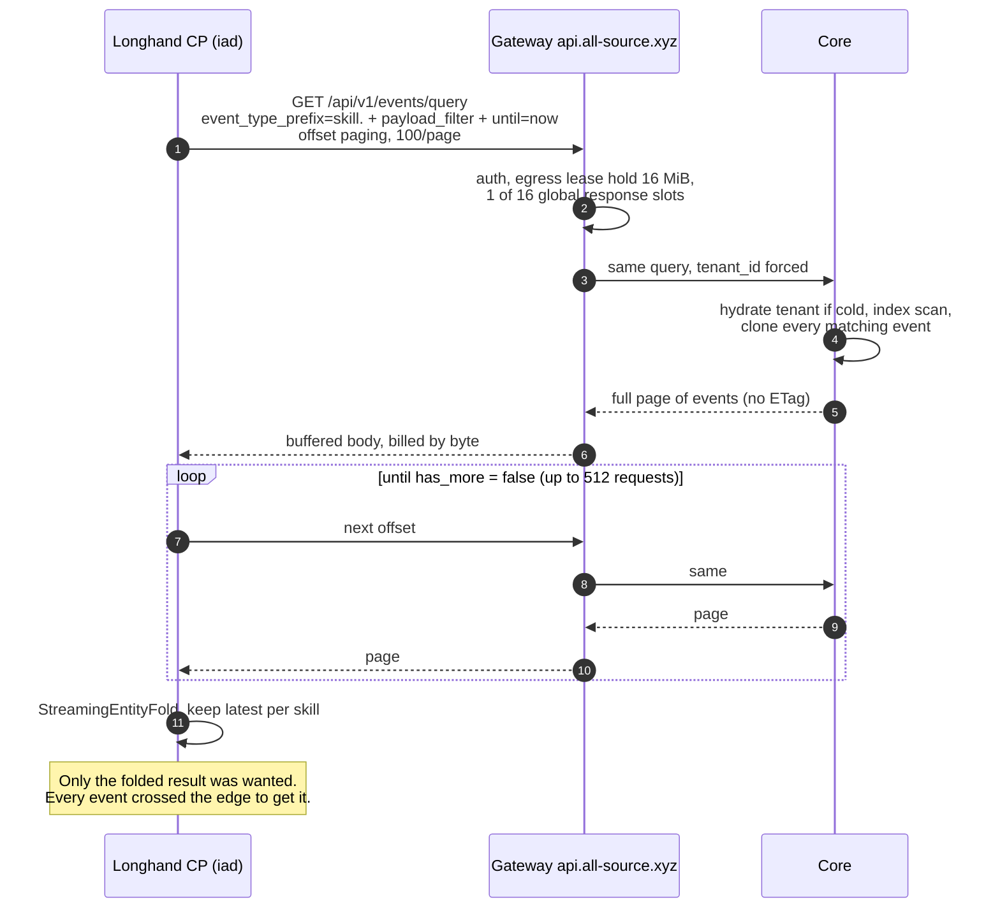
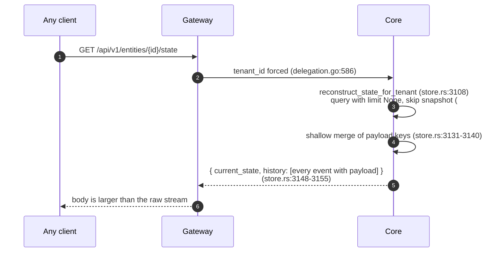
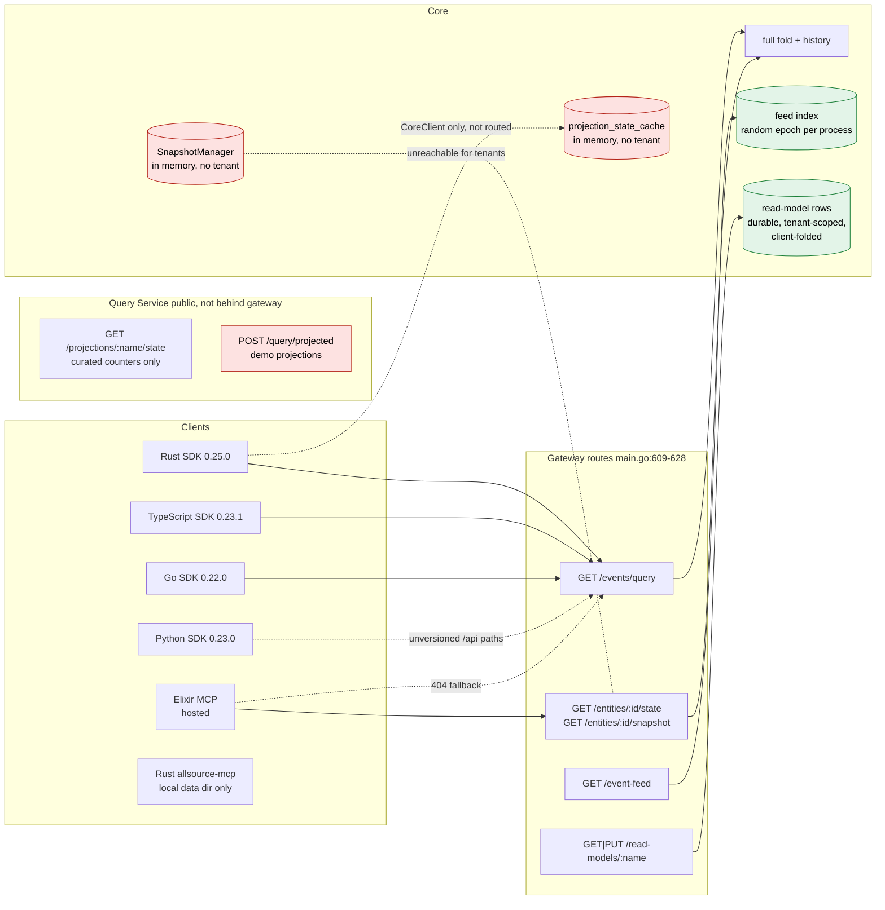
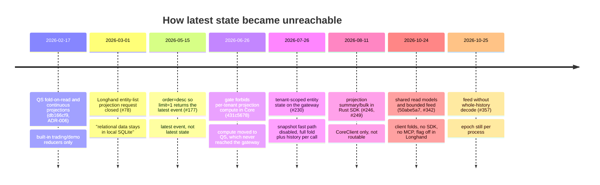
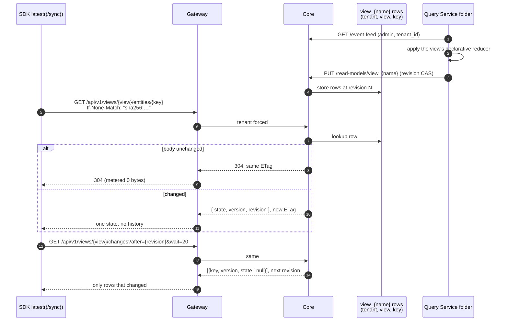
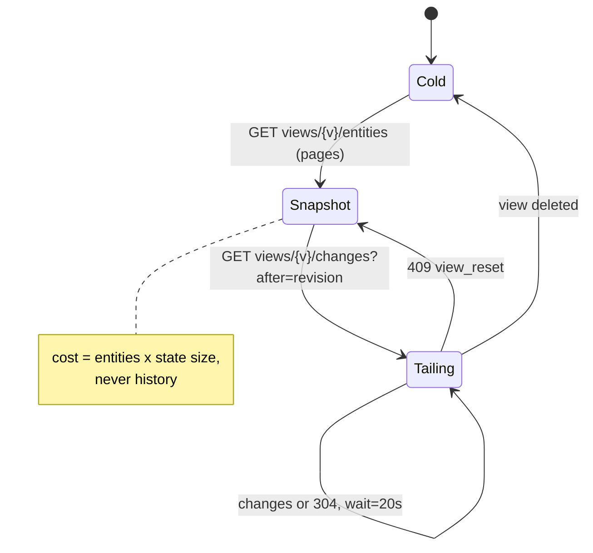

# Latest-state reads: why consumers still pull history, and the target design

**Question.** Can a consumer of AllSource get only the current state of its
entities through the SDK, the gateway, the Query Service and MCP, instead of
pulling event history over egress and folding it? If not, why not, and what
should exist?

**Answer.** No, not in a usable form. Core has six latest-state primitives, but
each one is either unreachable by tenants, more expensive than the raw stream,
or requires the consumer to run its own fold. No SDK wraps any of them. Every
production consumer read is `GET /api/v1/events/query` followed by a
client-side fold.

**Decision.** [ADR-021](../adr/021-views-folded-by-query-service.md) chose
option 2 under [Query Service](#query-service): the Query Service folds views
from the event feed and Core stores and serves the rows. The binding wire
contract is [`docs/contracts/latest-state/README.md`](../contracts/latest-state/README.md).
Where the target design below differs from what was built, the contract wins:

- The entity state route had no `history` parameter. It is new, defaults to
  `false`, and `history=true` restores the old body.
- A stale feed cursor is `409 version_conflict` (with `expected_version` and
  `current_version`), not `epoch_changed`. A stale `changes` cursor after a
  view rebuild is `409 view_reset`.
- Core never applies a reducer, on ingest or on read. The Query Service folds
  and commits rows; Core validates definitions and serves rows.
- The `changes` cursor is the read-model revision, journaled with each commit,
  so it survives a Core restart without the durable feed log. The feed log
  only spares the Query Service a rebuild.

All code references are `origin/main` at 2026-10-27 unless marked otherwise.
Longhand references are its `main`. Every claim below was read in code or in a
measured report; anything not read is listed under [Not verified](#not-verified).

## Contents

1. [What a consumer reads today](#what-a-consumer-reads-today)
2. [What exists, surface by surface](#what-exists-surface-by-surface)
3. [Why it is not used](#why-it-is-not-used)
4. [What it costs](#what-it-costs)
5. [How other event stores do it](#how-other-event-stores-do-it)
6. [Target design](#target-design)
7. [Bets](#bets)
8. [Not verified](#not-verified)

## What a consumer reads today

Longhand's control plane sets both `ALLSOURCE_CORE_URL` and
`ALLSOURCE_QUERY_URL` to `https://api.all-source.xyz`
(Longhand `control-plane/api/fly.toml:160-161`). The gateway sends every data
read to Core (`apps/control-plane/delegation.go`, `coreForTenant` in every
`Proxy*` handler). The Query Service is not on the path, although
`delegation.go`'s header comment still says reads go there.



The single-entity state route does not help:



## What exists, surface by surface



Green parts are tenant-safe and usable today. Red parts exist but cannot be
offered to tenants. No SDK has an edge to `/event-feed`, `/read-models`,
`/entities/:id/state` or `/entities/:id/snapshot`: `git grep -e event-feed -e
read-models -e /snapshots -e 'entities/{' origin/main -- sdks` finds only
`/api/v1/projections` paths in the Rust SDK.

### Core

| Primitive | Route | What it returns | Why a tenant cannot use it for latest state |
|---|---|---|---|
| Entity state | `GET /entities/{id}/state` | merged state plus `history[]` of every event | Body is larger than the stream (`store.rs:3148-3155`). No version, position or ETag. No parameter to omit history (`api.rs:903-910`). |
| Entity snapshot | `GET /entities/{id}/snapshot` | same as state when `tenant_id` is set | Stored snapshots have no tenant key, so scoped reads refold (`api.rs:934-939`). |
| Stored snapshots | `POST/GET /snapshots`, `/snapshots/{id}/latest` | snapshot list and latest | In-memory `DashMap` keyed by `entity_id` (`snapshot.rs:129-131`), lost on restart, 10 per entity, no tenant field. Not routed by the gateway. |
| Projection state | `/projections/{name}/{id}/state`, `/bulk`, `/state?entity_id_prefix` | state written by a worker or a registered projection | Cache keyed `name:entity` with no tenant (`store.rs:350`), in memory. Gateway does not route it (`main.go:616-617`: "must never be proxied bare"). |
| Latest event | `GET /events/query?entity_id=X&order=desc&limit=1` | newest event, with `entity_version` | Not folded state. One entity per call. No latest-per-entity mode for a prefix. |
| Event feed | `GET /event-feed?epoch&position&prefixes` | events with aligned positions, `head`, `caught_up` | Tenant-safe and bounded. Epoch is `Uuid::new_v4()` per index (`store_feed.rs:54`), so every restart or eviction invalidates every cursor. No long-poll. |
| Read models | `GET/PUT /read-models/{name}` | keyed rows, `revision`, `checkpoint`; `revision=` gives `unchanged: true` | Tenant-safe and durable. The fold stays in the consumer by design. A changed prefix returns the whole prefix again (`store_read_model.rs:268-286`). |

Core never emits `ETag` or `304`: `git grep -i -E 'etag|if-none-match|not_modified'
origin/main -- apps/core/src` returns nothing. The gateway forwards
`If-None-Match`, copies `ETag` back and meters a 304 as zero bytes
(`delegation.go:270-293`), and the Rust SDK sends `If-None-Match`
(`sdks/rust/src/client.rs:428-448`). Both halves are dead until Core answers.

### Gateway

- Data routes are an explicit allowlist (`main.go:609-628`) with no catch-all.
  Latest-state routes: `events/query`, `event-feed`, `read-models/:name`,
  `entities/:id/state`, `entities/:id/snapshot`.
- Every billable response is buffered whole, capped at 16 MiB and charged by
  buffered length (`egress_guard.go:23,185,200`). Streaming, SSE and WebSocket
  are refused (`egress_guard.go:368-373`).
- Default managed keys carry `projections:read` but not `projections:write`
  (`managed_keys.go:69`), so a default managed key cannot commit a read model.
- The advertised billing unit is bytes before compression
  (`egress_billing.go:27`), but the guard charges what it buffered, which is
  Core's gzip output when the client sends `Accept-Encoding`.

### Query Service

- Not on the gateway path. It has its own public Fly service (`fly ips list -a
  allsource-query`: dedicated IPv6 and shared IPv4).
- Tenant-scoped latest state exists only for five curated metadata templates
  (event count, type leaderboard, events per day, entity activity, active
  entities), one entity per call, lost on restart
  (`tenant_projections.ex:194-200`). User reducers were a v1 non-goal
  (`docs/proposals/PER_TENANT_PROJECTIONS.md`).
- `/api/v1/snapshots` and `/api/query/projected` are built on the legacy Core
  snapshot store and demo projections, both keyed without a tenant. They have
  to be retired, not extended.
- The demo `ProjectionServer`s subscribe to `events:type:<type>`
  (`projection_server.ex:78-79`), a topic nothing publishes, so they hold only
  their boot-time hydrate.

### SDKs

| | Rust 0.25.0 | TypeScript 0.23.1 | Go 0.22.0 | Python 0.23.0 |
|---|---|---|---|---|
| Server-folded state of one entity | no (projection KV on `CoreClient` only) | no | no | no |
| Latest of many by prefix | no | no | no | no |
| Event feed / read models | no | no | no | no |
| `entity_version` in query response | no (Core sends it, `event_dto.rs:86`) | no | no | no |
| Conditional query | `If-None-Match` sent, never answered | no | no | no |
| Client fold helper | `query_and_fold` | `queryAndFold` | `QueryAndFold` | none |
| Routes the gateway does not serve | `list_entities`, `list_projections`, `replay` | `/projections`, `/replay*` | `/projections`, `/replay*` | all of `/api/events*`, `/api/projections*` |

Longhand works around the SDK in two places with raw `reqwest`: an
`entity_version` probe (`versioned_query.rs:145`: "The SDK omits
entity_version, so bracket its payload read with two probes") and the whole
feed/read-model client (`shared_projection.rs:252,337,374,393`).

### MCP

| Server | Latest-state tool | How it gets there |
|---|---|---|
| Rust `allsource-mcp` | `fold_entity_lifecycle` | Scans raw events 500 per page up to 50,000, folds in process, returns at most 500 entities with no next cursor (`tools.rs:24-26,985`). Fields come from the latest event, not merged state (`tools.rs:1055`). |
| Rust `allsource-mcp` | `get_snapshot` | Refused for hosted tenants: "tenant-scoped projection reads are unavailable" (`tools.rs:1388-1390`). No remote backend at all; reads a local data dir. |
| Elixir MCP (hosted) | `get_snapshot`, `reconstruct_state` | Calls the entity routes, so it inherits the full-history body. On 404/405 falls back to pulling up to 10,000 events (`core_client.ex:62-68`), a fallback written before the gateway routed those paths the same day (#229, #230). |
| `prime-mcp` | `prime_search(type)` | Prime graph only. Hosted mode hydrates by pulling every `prime.*` event for the tenant in one unpaged request (`tenant_cache.rs:128-134`). |

## Why it is not used

The record shows no decision against a latest-state API. It shows a sequence of
decisions that each made one more path unavailable, and no replacement.



1. **Tenant isolation removed the only snapshot path.** Snapshots and
   projection state were built before tenancy and are keyed by `entity_id`.
   #230 correctly refused to serve them to scoped callers and folded instead.
   Nothing re-keyed them.
2. **The state route ships history.** With history in the body, the state
   route costs more than `events/query`, so every consumer rationally folds
   client-side.
3. **Compute was placed in a service no customer reaches.** The 2026-06-26 gate
   put per-tenant projection compute in the Query Service, and the gateway never
   routed to it. The proposal named the exception itself: "durable materialized
   views that must survive QS restarts" belong in Core. Latest state is that
   case.
4. **Generic merge is not a domain fold.** Core's reducer is a shallow
   last-write-wins merge of payload keys with no deletes. Longhand's folds are
   guarded state machines and imports with admission rules
   (Longhand `docs/reports/2026-09-29-allsource-server-side-reads.md:42-45`),
   so the generic state was wrong for it even where reachable. Longhand moved
   its derived snapshots to R2 (Longhand ADR-097) after writing them as events
   made `team_queue.snapshot.chunk` 81% of the tenant's bytes.
5. **The incremental path is new, consumer-folded and unpackaged.** Event feed
   and read models landed on 2026-10-24, touched no SDK, QS or MCP file, failed
   in production for the Longhand tenant until #355 and #357, and are behind
   `LONGHAND_SHARED_QUEUE_PROJECTION`, which is unset in Longhand's
   `fly.toml [env]`.
6. **Change detection was deferred.** The polling-defence plan made ETag/304
   and heads conditional on forward reads landing first
   (`docs/plans/2026-10-24-tenant-polling-defense.md`, P6).

## What it costs

Measured figures, from the reports and commits that measured them.

| Measure | Value | Source |
|---|---|---|
| Gateway edge output, 24 h to 2026-10-24 17:20Z | 66.0 GB, 99.5% event-query bodies | `docs/reports/2026-10-24-control-plane-egress-rca.md` |
| Peak day before alerting | 935 GB (10-21) | same |
| Largest read shape | prefix, time-bounded, payload-filtered: 55% of bytes, ~361 KB mean | same |
| Skill catalog replay | 7.29 GB in ~23 h, 24,115 queries, ~532 KB per skill read | Longhand `43666bbe8` |
| Status page history walk | 684 MB in 2 h (10:18-12:18Z on 10-26), 5,451 reads | Longhand `d6b8f03a0` |
| `team_queue.snapshot.chunk` share of tenant bytes | 81% | `docs/reports/2026-10-25-control-plane-tenant-outage.html` |
| Read-model and feed outcome during the 10-25 outage | read-models 4,863 × 5xx, event-feed 0 × 2xx, events/query 68,804 × 2xx | same |

Every row is a consumer pulling history to compute something the store could
have kept current. Longhand built three caches to survive it: the skill catalog
count probe, the status-history cache, and the R2 derived snapshots.

## How other event stores do it

| Store | Pattern | Source |
|---|---|---|
| Marten | `FetchLatest<T>(id)` returns the stored projection for inline, stored projection plus tail for async, full fold for live. One call hides the strategy. | martendb.io/events/projections/read-aggregates.html |
| Equinox | "Tip" document holds snapshot ("unfolds") and the next append index, written atomically with events. One point read; etag-checked cached read costs 1 RU when unchanged. | github.com/jet/equinox |
| Axon | Snapshot by event-count threshold; load = latest snapshot plus later events. Snapshot schema versioned, stale ones filtered. | docs.axoniq.io, event-snapshots |
| KurrentDB | Catch-up subscription from an exclusive position with an explicit `CaughtUp` marker; `$maxCount=1` streams for snapshots; projection state per partition. | docs.kurrent.io |
| Debezium | Consistent snapshot at position N, then stream from N. Re-snapshot when the offset has expired. | debezium.io, PostgreSQL connector |
| Firestore | `onSnapshot`: the first result is every matching document as `added`, then `docChanges` deltas. | firebase.google.com/docs/firestore/query-data/listen |
| Kafka | Compacted topic keeps the latest value per key; KTable and ksqlDB pull queries read it by key. | docs.confluent.io, log compaction |
| HTTP | `ETag` = version, `If-None-Match` → `304` with no body. | RFC 9110 |

The bar these set, as a checklist:

| | Requirement | AllSource today |
|---|---|---|
| a | `latest(id)` returns state and version in one round trip | Full fold plus history, no version |
| b | Latest of many entities by type or prefix, paginated, server-side | None |
| c | Every state response carries a position; the client continues from it with no gap and no duplicate | Feed has positions; state routes do not |
| d | Resumable cursor that survives server restarts | Epoch dies with the process |
| e | `ETag` equal to the version; `304` when unchanged | Gateway and Rust SDK ready; Core silent |
| f | Snapshots written atomically or versioned so stale ones are ignored | In memory, untenanted, unversioned schema |
| g | One SDK call that hides snapshot vs snapshot-plus-tail vs fold | None |
| h | Reducers a tenant can define without running code | Prime has declarative merge policies; events do not |

## Target design

### Principle

Store the latest state next to the events, keyed by tenant, versioned by the
read-model revision that wrote it, and served as **snapshot plus tail**. A
consumer never reads history unless it asks for history.

### Contract



| Route | Purpose |
|---|---|
| `PUT /api/v1/views/{view}` | Define a view: event-type prefix, entity key, declarative reducer (below). Versioned; a new definition rebuilds under a new generation and swaps atomically. |
| `GET /api/v1/views/{view}/entities/{key}` | Latest state of one row: `state`, `version`, `revision`, `generation`. `ETag`/`304`. |
| `GET /api/v1/views/{view}/entities?prefix&after&limit` | Latest state of many, cursor-paginated, with a `revision` watermark for the whole page. |
| `GET /api/v1/views/{view}/changes?after&limit&wait` | Rows changed after a read-model revision, including deletes. Long-poll with `wait`. |
| `GET /api/v1/entities/{id}/state?history=false` | Existing route; the `history` parameter is new, `false` by default. `version` and `ETag` added. Back-compat: `history=true`. |

`view` generalises the read model that already exists: same rows, same
revision CAS, same journal (`store_read_model.rs`). The difference is who folds.
Today the consumer folds and PUTs rows. With a view definition, the Query
Service folds the feed into the same rows and commits them, and a consumer
that needs a fold the reducer set cannot express keeps committing rows itself,
as Longhand does now.

### Declarative reducers

Code-free, so the tenant boundary and the hot ingest path stay safe. Prime
already ships the shape (`define_projection` with `last_write`,
`highest_priority`, `most_specific`, `merge_array`, persisted as events,
`apps/core/src/prime/facade.rs:1967-2028`).

| Operation | Example |
|---|---|
| `set` fields from payload (last writer by position) | `status`, `name` |
| `unset` / tombstone on an event type | `skill.retired` deletes the row |
| `status` from event-type suffix with allowed transitions | queue item lifecycle |
| `append` / `remove` on a set field | members, tags |
| `increment` | counters |
| `max` / `min` by field | `last_seen_at` |

Anything outside this set stays a consumer fold over `/event-feed` with rows
committed to the view, which is the read-model protocol unchanged.

### Positions that survive restarts

The feed epoch is random per process (`store_feed.rs:54`), so a feed cursor
dies with the process. The `changes` cursor is not a feed position: it is the
read-model revision, journaled with each commit, so `changes?after=` survives
a deploy with no feed log. A Core restart costs the Query Service folder a
rebuild (`409 version_conflict` on the feed, then `reset: true`), and the
durable per-tenant feed log (plan P2,
`docs/plans/2026-10-25-feed-without-whole-history.md`, behind
`ALLSOURCE_FEED_DURABLE_LOG`) removes that rebuild. An SDK re-reads the entity
pages only on `409 view_reset`, after a new definition or a rebuild, and those
pages are bounded by row count, not history.



### SDK surface (all four, one contract test)

```text
latest(view, key)                 -> { state, version, revision } | NotModified
latestMany(view, {prefix})        -> async pages, revision watermark per page
sync(view, checkpoint)            -> async stream of upserts and deletes + checkpoint
readModel(name)                   -> existing feed + rows protocol, packaged
```

`sync` does snapshot-then-tail with the state machine above, keeps an ETag
cache, honours `Retry-After` and resumes from a stored checkpoint. Query
responses expose `entity_version`. A shared contract test runs every SDK
against the same Core build, so the parity gaps in the SDK table cannot
reopen.

### MCP

- Hosted (Elixir): `get_latest_state(view, id)`, `list_latest(view, prefix,
  cursor)`, `list_changes(view, after)`. Remove the 404 fold fallback.
- Rust `allsource-mcp`: an HTTP backend so the same tools work against a hosted
  tenant; `fold_entity_lifecycle` gains a next cursor.

### Query Service

Two options were weighed; [ADR-021](../adr/021-views-folded-by-query-service.md)
chose the second:

1. **Views folded in Core.** The rows and journal are already in Core,
   tenant-scoped and durable, but the 2026-06-26 gate would need an amendment
   to allow per-tenant reducer compute on the ingest path.
2. **Views computed in QS, stored in Core** (chosen). QS runs reducers from the
   feed and commits rows. Keeps the gate, adds a hop and a second failure
   domain to every latest-state change. QS also retires `/snapshots` and
   `/query/projected`.

### Things to fix on the way regardless

- Re-key or delete the legacy `SnapshotManager` and `projection_state_cache`;
  retire the QS routes built on them.
- Gateway: correct the "reads go to Query Service" comment; settle the billing
  unit (pre- or post-compression) and test it.
- SDKs: TypeScript, Go and Python call routes the gateway does not serve; the
  Python SDK uses unversioned `/api/*` paths against the gateway default URL.
- Public docs (`apps/web/src/app/(marketing)/docs/api/page.tsx:24,34`) list
  `/projections` and `/snapshots`, which the gateway does not serve, and omit
  the routes it does.

## Bets

Tiers are confidence, not size. Each names what would move it up.

| # | Bet | Tier | Moves up when |
|---|---|---|---|
| 1 | `history=false` default on entity state, `version` field, Core `ETag`/`304` on state and `events/query` | rock | — |
| 2 | `entity_version` in all SDK query responses; feed and read-model clients in all four SDKs | rock | — |
| 3 | Retire untenanted snapshot/projection paths in Core and QS | rock | — |
| 4 | Durable feed positions (plan P2) | sand | the durable per-tenant feed log is shaped against the 2026-10-25 archive sizes |
| 5 | Views: declarative reducers folded by the Query Service into Core read-model rows, snapshot-plus-tail reads | sand | ADR on the Core/QS boundary; reducer set validated against Longhand's skill catalog, org vault and queue folds |
| 6 | `changes?after&wait` long-poll through a buffer-and-bill gateway | water | spike: whether a held request fits `egress_guard.go`'s 10 s deadline and 16-slot pool, or needs its own lane |
| 7 | MCP tools and remote backend over views | rock once 5 lands | — |

Bets 1-3 change no architecture and remove the reason consumers fold the state
route. Bet 5 is the one that removes history from Longhand's reads; its egress
effect has not been measured and should be, per read shape, with the gateway's
shape counters before and after.

## Not verified

- Production values of `LONGHAND_SHARED_QUEUE_PROJECTION`,
  `ALLSOURCE_ADMISSION_MODE` and `EGRESS_LEASE`; Longhand Fly secrets that could
  override the `[env]` URLs.
- Whether production Core overrides `SnapshotConfig` defaults (auto-snapshot at
  100 events or 3600 s).
- Published registry versions of the four SDKs (only repo manifests read).
- Whether the Fly edge routes unversioned `/api/*` on `api.all-source.xyz`
  anywhere other than the gateway.
- Egress reduction from any bet above: not measured; nothing here predicts it.
- External sources: KurrentDB projection consistency, ksqlDB pull-query
  staleness, and Firestore resume-token mechanics were not stated on the pages
  read.
